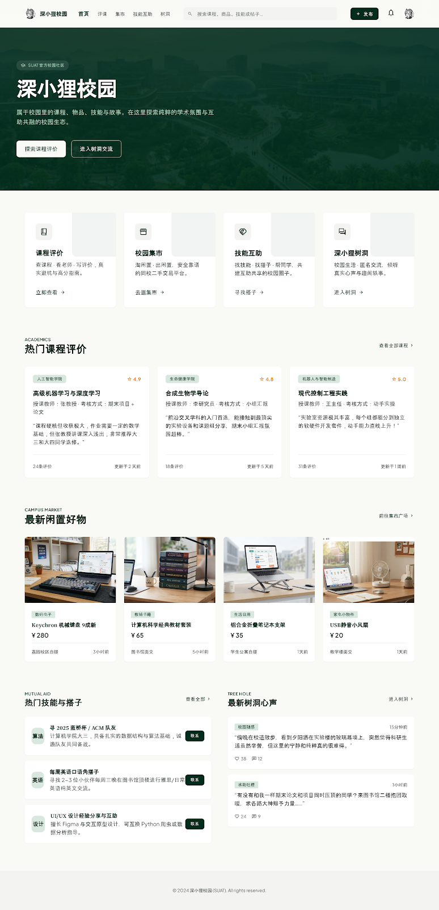

# 深小狸校园 · Shenxiaoli Platform

> 学生共建的非官方校园社区，服务于深圳理工大学（SUAT）的同学。
> 评课 · 集市 · 技能互助 · 树洞

[](LICENSE)


[](CONTRIBUTING.md)



上图及 `docs/screenshots/` 中的图片为早期设计参考，不代表当前功能或运行数据。

## 项目与功能

深小狸校园是 Bun + Vite + Tailwind + TypeScript 前端与 Bun + Hono + SQLite
后端组成的 monorepo。前端使用多页 HTML 与按页面加载的 TypeScript 模块，公共页眉、
页脚和样式在 Vite HTML 转换阶段注入。

| 功能       | 当前能力                                                                                     |
| ---------- | -------------------------------------------------------------------------------------------- |
| 评课       | 课程筛选、开课与教师关联、评价发布、评论、收藏；管理员维护目录和分阶段导入 CSV               |
| 集市       | 商品筛选、发布、图片上传、状态维护、联系请求、评论与收藏                                     |
| 技能互助   | 技能分享和求助、按分类与标签推荐、互助申请、双方确认完成、反馈及争议处理                     |
| 树洞       | 匿名展示、话题筛选、共鸣、评论、举报；发布者可维护自己的内容                                 |
| 搜索与首页 | 首页数据聚合、跨模块搜索建议、独立搜索结果页和内容定位                                       |
| 个人中心   | 我的发布、收藏、联系请求、私信、互助记录、通知、申诉与账号设置                               |
| 账号与通知 | 校园邮箱验证码登录、昵称和邮箱管理、撤销会话、验证码确认注销；站内通知和可设置的社交邮件提醒 |
| 社区治理   | 举报处置、警告/禁言/封禁、独立人员复核申诉、互助争议处理与审计记录                           |

评课与树洞目前**提交后直接发布**，后续通过举报和社区治理处理违规内容。
业务内容通常需要登录后读取和互动，项目说明、规则和隐私页面可公开访问。

本项目由学生自发维护，与深圳理工大学校方无隶属关系，也不代表校方立场。
登录仅接受精确的 `@stu.suat-sz.edu.cn` 和 `@suat-sz.edu.cn` 邮箱域；邮箱验证证明
邮箱控制权，不代表学籍或真实身份已经核验。树洞对普通用户隐藏发布者账号标识，
平台内部仍保留账号关联以执行限流、治理和必要审查。

## 快速开始

CI 和 Docker 使用 **Bun 1.3.14**，建议本地使用相同版本，并准备现代浏览器。
两侧依赖和锁文件独立，根目录没有共享的依赖安装。

在仓库根目录执行：

```bash
bun run setup
bun run dev
```

- 前端：<http://127.0.0.1:5173>（端口占用时 Vite 可能使用后续端口）。
- API：<http://127.0.0.1:8787>。
- Vite 将 `/api/*` 和 `/uploads/*` 代理到 API，浏览器使用同源 URL。
- 本地默认启用合成演示数据与学生/审核员演示登录，可从页眉账号菜单选择；演示审核员不等同于课程管理员。
- 数据库默认位于 `backend/data/shenxiaoli.sqlite`，图片位于 `backend/uploads/`，均忽略于 Git。

`bun run dev:api` 和 `bun run dev:web` 可分别启动两个服务。开发模式自动执行数据库
迁移。校园邮箱登录需要额外配置 Resend；独立邮件 worker 不随 `bun run dev` 启动，
配置方法见[运维文档](docs/OPERATIONS.md)。

### 页面入口

| 路径                      | 页面                                       |
| ------------------------- | ------------------------------------------ |
| `/index.html`             | 首页                                       |
| `/course-evaluation.html` | 评课                                       |
| `/market.html`            | 集市                                       |
| `/skill-mutual-aid.html`  | 技能互助                                   |
| `/tree-hole.html`         | 树洞                                       |
| `/search.html`            | 搜索结果                                   |
| `/account.html`           | 个人中心与账号管理                         |
| `/information.html`       | 项目介绍、社区规则、隐私政策与联系反馈     |
| `/moderation.html`        | 社区审核；课程导入与维护功能另需管理员权限 |

### 检查与构建

以下命令均从仓库根目录执行：

```bash
bun run lint
bun run format:check
bun run typecheck
bun run test
bun run build
```

`test` 运行后端 API 集成测试；`build` 安装锁定依赖并分别构建两包，前端构建还会执行
类型检查。`preview` 仅预览 `frontend/dist/`，没有开发代理、API 或 worker。
根目录检查主要覆盖两包代码，修改根目录或 `docs/` 下的 Markdown 时还需单独检查格式。

## 运行与部署方式

| 方式     | 组成与用途                                                                                 |
| -------- | ------------------------------------------------------------------------------------------ |
| 本地开发 | Vite + API，默认演示登录与合成数据，适合开发联调                                           |
| 静态预览 | `bun run preview`、`bun run deploy` 或 GitHub 静态部署，只提供前端文件                     |
| 完整部署 | Docker Compose：Caddy + API + SQLite 数据卷 + 上传卷 + 独立 worker；先执行迁移，再启动服务 |

完整部署步骤见[生产部署与恢复](docs/OPERATIONS.md)。Compose 固定使用生产模式并关闭
演示登录，使用 `.env.demo.example` 也不会改变此行为。正式开放前仍需提供站点与服务器、
认证过的 Resend 发件域、真实课程数据、管理员和审核团队，配置异地加密备份，完成双域
真实收信测试、恢复演练与端到端验收。

**已知限制：** 当前 `/uploads/*` 图片读取路由未经过 `/api/*` 的会话解析中间件，
已登录图片请求也会返回 401；图片上传接口已实现，但读取闭环需修复后再验收。
现有 API 测试不等同于生产部署验证。学校 SSO、学籍核验和教务自动同步尚未实现。

## 项目结构

```text
.
├── frontend/                 # @shenxiaoli/frontend，多页客户端及独立锁文件
│   ├── src/*.html            # 九个 HTML 入口
│   ├── src/scripts/          # layout、main、api、auth-client 和各功能模块
│   ├── src/styles/           # main.css 与 tokens.css
│   ├── public/               # favicon 等静态资源
│   └── vite.config.ts        # 页面入口、公共布局转换与开发代理
├── backend/                  # @shenxiaoli/backend，独立依赖及锁文件
│   ├── src/app.ts            # 业务 API、权限、限流和治理
│   ├── src/db.ts             # SQLite schema、版本迁移与开发数据
│   ├── src/auth.ts           # Better Auth 校园邮箱 OTP 与 Resend 发送
│   ├── src/index.ts          # API 入口与生产配置检查
│   ├── src/worker.ts         # 通知邮件消费及周期清理
│   ├── src/notifications.ts  # 通知邮件入队、去重、重试
│   ├── src/maintenance.ts    # 注销账号与到期证据清理
│   ├── src/migrate.ts        # 显式数据库迁移
│   ├── src/admin.ts          # 向已验证邮箱授予管理员权限
│   ├── src/backup.ts         # 一致数据库快照
│   ├── src/restore.ts        # 数据与图片恢复、校验和回滚副本
│   ├── test/api.test.ts      # 内存 SQLite API 集成测试
│   └── README.md             # API 参考
├── docs/                     # 架构、设计、运维与历史截图
├── ops/                      # Restic 备份/恢复脚本
├── scripts/dev.ts            # 同时启动前端和 API
├── .github/workflows/        # 双包 CI 与静态前端部署
├── .env.production.example   # Compose 配置示例
├── .env.demo.example         # 示例站点配置，Compose 仍以生产模式运行
├── Dockerfile                # 前端构建、API 与 Caddy 镜像阶段
├── compose.yaml              # 服务、持久卷与独立迁移任务
├── Caddyfile                 # 同源 HTTPS 与 API/图片反向代理
├── package.json              # 根目录协调脚本
└── rth-host.json             # 静态托管目标 frontend/dist
```

## 文档导航与参与贡献

| 文档                                 | 用途                                            |
| ------------------------------------ | ----------------------------------------------- |
| [后端 API](backend/README.md)        | 认证、权限、路由、分页、示例和 CSV 导入         |
| [项目架构](docs/ARCHITECTURE.md)     | 数据流、前端扩展、账号与内容状态、存储边界      |
| [生产部署与恢复](docs/OPERATIONS.md) | 配置、迁移、邮件、备份、恢复与上线验收          |
| [设计规范](docs/DESIGN.md)           | Deep Forest Emerald Academic 视觉令牌与交互规范 |
| [贡献指南](CONTRIBUTING.md)          | 双包开发、检查、PR 和文档维护                   |
| [变更记录](CHANGELOG.md)             | 未发布功能与项目历史                            |
| [安全政策](SECURITY.md)              | 私密漏洞报告与安全范围                          |
| [行为准则](CODE_OF_CONDUCT.md)       | 社区协作与行为投诉                              |

设计令牌定义于 `frontend/tailwind.config.ts` 和 `frontend/src/styles/tokens.css`，
修改时需同步两处和设计文档。新增页面的注册及运行时分发步骤见架构文档。
当前界面以中文为主；多语言支持尚未实现。

欢迎提交问题、设计反馈、文档修正与 PR。安全问题请按安全政策私密报告。

## 许可证

[MIT](LICENSE) © 2026 Shenxiaoli Platform Contributors.

## 致谢

- 灵感来自 **SUAT — 深圳理工大学 / Shenzhen University of Advanced Technology** 的校园文化；本项目由学生自发维护，与校方无关。
- 同类学生评课及校园社区项目参考：
  - [USTC iCourse](https://github.com/USTC-iCourse/ustc-course) — 中科大评课平台
  - [NWU.ICU](https://github.com/NWUCA/NWU.ICU) — 西北大学课程评价
  - [YourTJ](https://github.com/YourTongji/YourTJCourse-Serverless) — 同济选课社区
  - [jCourse](https://github.com/SJTU-jCourse/next) — 上交选课社区
  - [CourseBench](https://github.com/ShanghaitechGeekPie/coursebench-next) — 上科大 CourseBench
- 视觉体系沿用 **Deep Forest Emerald Academic** 配色与排版。
- 感谢 Bun、Hono、Better Auth、Resend、Vite、Tailwind CSS 和 TypeScript 等开源工具。
